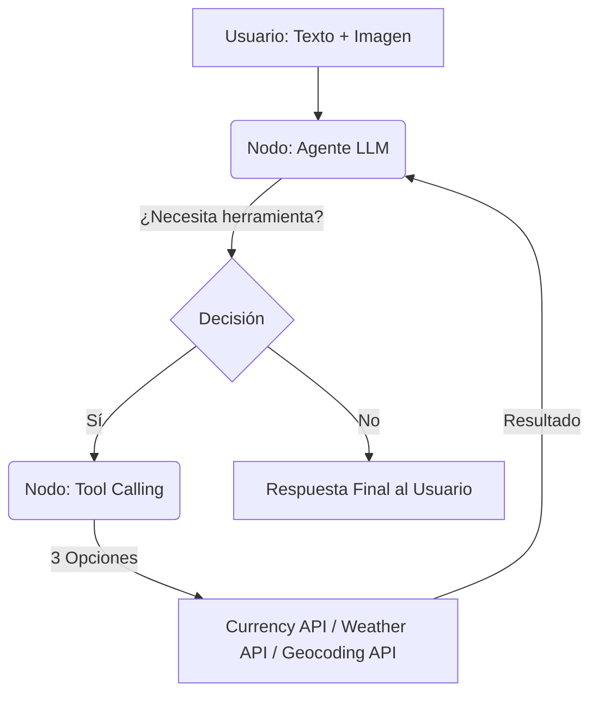
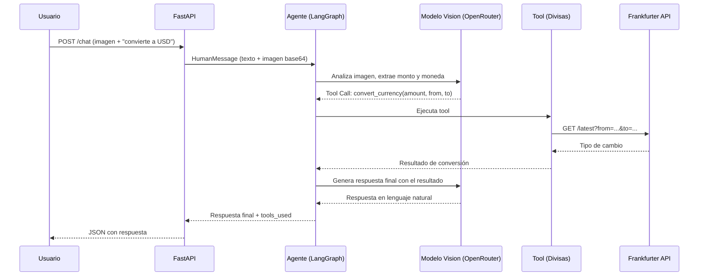

# Architecture Design - LangGraph Agent

## 1. Flujo del Grafo (State Machine)
A diferencia de una cadena lineal (LCEL), el agente usa un grafo con ciclos.

## 2. Flujo de una Consulta Multimodal

## 3. Componentes de Software

- `API Layer`: FastAPI (endpoints asíncronos, soporte para form-data con archivos).
- `Agent Engine`: StateGraph de LangGraph con nodos agent y tools.
- `Tools`: Funciones decoradas con @tool que usan httpx para llamadas HTTP.
- `LLM Factory`: Configurable vía .env para usar OpenRouter, OpenAI, Google o Groq.

## 4. Patrones de Diseño Aplicados
- **Registry Pattern (LLM Factory):** Utilizado en `llm_factory.py`. En lugar de usar estructuras condicionales (`if/elif`) para instanciar el proveedor de IA, se utiliza un diccionario (`_PROVIDER_REGISTRY`) que mapea el nombre del proveedor (`OPENROUTER`, `OPENAI`, etc.) a su función constructora. Esto respeta el principio Open/Closed (SOLID), permitiendo agregar nuevos proveedores sin modificar la función principal `get_llm()`.
- **State Machine:** LangGraph modela el agente como un grafo de estados con transiciones condicionales.
- **Resilience Pattern:** Las tools capturan excepciones y retornan mensajes controlados en lugar de propagar errores.