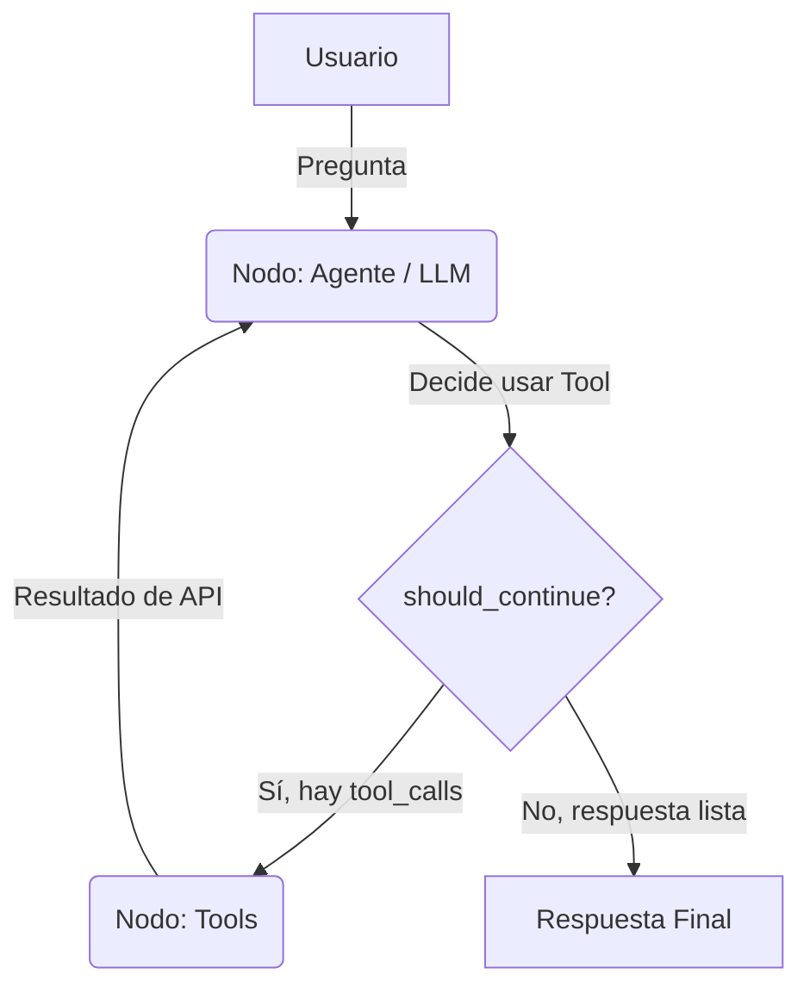

# Principios SOLID y Patrones de Diseño

Este documento detalla las decisiones arquitectónicas tomadas para garantizar que el agente sea mantenible, escalable y fácil de testear, aplicando los principios SOLID y patrones de diseño de la industria.

## 1. Principios SOLID Aplicados

### S - Single Responsibility Principle (Responsabilidad Única)
Cada módulo tiene una única razón para cambiar:
- **`config.py`:** Solo se encarga de cargar y validar variables de entorno.
- **`agent_engine.py`:** Solo define la estructura del grafo y la lógica de razonamiento.
- **`tools/`:** Cada archivo maneja una única integración externa (divisas, clima, geocodificación).
- **`main.py`:** Solo expone la API REST y maneja las peticiones HTTP.

### O - Open/Closed Principle (Abierto/Cerrado)
El código está abierto para extensión pero cerrado para modificación:
- **`llm_factory.py`:** Usando el **Registry Pattern**, si mañana se necesita agregar un nuevo proveedor (ej. Anthropic), solo se crea la función `_build_anthropic()` y se agrega una línea al diccionario `_PROVIDER_REGISTRY`. La función `get_llm()` no se modifica.
- **`tools/`:** Si se requiere una nueva herramienta (ej. enviar correos), se crea un nuevo archivo y se agrega a la lista `tools` en `__init__.py`, sin tocar el grafo del agente.

### L - Liskov Substitution Principle (Sustitución de Liskov)
Todos los LLMs retornados por `get_llm()` heredan de `BaseChatModel` de LangChain. Esto garantiza que, sin importar si el proveedor es OpenAI, Google o Groq, el agente pueda invocar métodos como `.invoke()` o `.bind_tools()` de forma transparente.

### I - Interface Segregation Principle (Segregación de Interfaces)
Las herramientas (Tools) no obligan al agente a depender de métodos que no usa. LangChain genera automáticamente un esquema de argumentos (`args_schema`) para cada tool basándose únicamente en los parámetros que necesita (ej. `amount`, `from_currency`, `to_currency`), ignorando la lógica interna.

### D - Dependency Inversion Principle (Inversión de Dependencias)
El agente (`agent_engine.py`) no depende de implementaciones concretas (como `ChatOpenAI`), sino de la abstracción `BaseChatModel` proporcionada por el Factory. Además, las URLs de las APIs externas están en `config.py` (inyectadas vía `.env`), no hardcodeadas en las Tools.

---

## 2. Patrones de Diseño Implementados

### A. Registry Pattern (Fábrica de LLMs)
**Ubicación:** `app/core/llm_factory.py`
**Problema:** Evitar bloques gigantes de `if/elif` para instanciar diferentes proveedores de IA.
**Solución:** Un diccionario que mapea el nombre del proveedor a su función constructora. Permite escalar horizontalmente sin modificar el flujo principal.

### B. Strategy / Provider Fallback Pattern
**Ubicación:** `app/tools/`
**Problema:** Depender de una sola API externa (ej. OpenWeather) genera un punto único de fallo o requiere pagar por límites más altos.
**Solución:** Las herramientas verifican si existe una API Key comercial en el `.env`. Si existe, usan el proveedor comercial (Strategy A). Si no, conmutan automáticamente a la API gratuita (Strategy B). Esto se aplica en divisas, clima y geocodificación.

### C. Circuit Breaker / Graceful Degradation
**Ubicación:** `app/tools/` + `agent_engine.py`
**Problema:** Si una API externa falla (Timeout, Error 500), el sistema no debe colapsar.
**Solución:** Las Tools capturan las excepciones (`httpx.TimeoutException`, `HTTPStatusError`) y retornan strings controlados en lugar de lanzar errores. El System Prompt del agente le indica que, si recibe un error, debe informar al usuario elegantemente sin inventar datos (evitando alucinaciones).

### D. State Machine Pattern (LangGraph)
**Ubicación:** `app/services/agent_engine.py`
**Problema:** Los agentes no son flujos lineales; necesitan ciclos de razonamiento (Pensar → Actuar → Observar).
**Solución:** LangGraph modela el agente como una máquina de estados (`StateGraph`). El estado (`AgentState`) acumula los mensajes (`HumanMessage`, `AIMessage`, `ToolMessage`), y las aristas condicionales (`conditional_edges`) permiten que el agente decida cuándo usar una herramienta y cuándo terminar.

---

## 3. Grafos de Estados (LangGraph)

El flujo de razonamiento del agente está modelado de la siguiente manera:

### Explicación del Flujo:

1. **Nodo** `agent`: Es el cerebro. Recibe el historial de mensajes y decide si responde directamente o si invoca una herramienta.
2. **Arista condicional** `should_continue`: Evalúa el último mensaje del LLM. Si contiene `tool_calls`, el flujo va hacia el nodo `tools`. Si no, va hacia el final (`END`).
3. **Nodo** `tools`: Ejecuta la herramienta solicitada (ej. `convert_currency`) y devuelve el resultado como un `ToolMessage`.
4. **Ciclo de Retorno**: Después de ejecutar la herramienta, el flujo **vuelve al nodo** `agent` (esto permite el *Tool Chaining*, donde el agente puede decidir usar una segunda herramienta basándose en el resultado de la primera).
5. **Acumulación de Estado**: Gracias al operador `operator.add` en el `AgentState`, cada nuevo mensaje se suma a la lista, garantizando que el agente nunca pierda el contexto de lo que ya hizo.