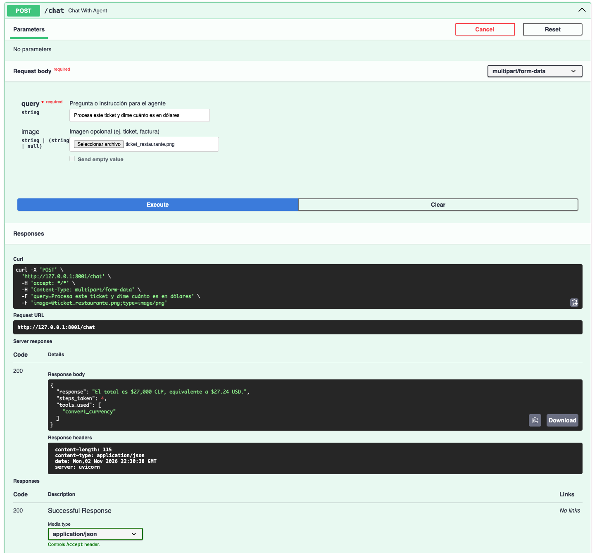

# 🤖 Autonomous Multi-Tool Agent

Un agente autónomo de nivel producción construido con **LangGraph** y **FastAPI**, diseñado para razonar, decidir y ejecutar acciones mediante el uso de herramientas externas (APIs REST). 

Este proyecto va un paso más allá de un chatbot tradicional: implementa un **ciclo de razonamiento ReAct** (Reason + Act), capacidades **multimodales** (procesamiento de imágenes) y una **arquitectura resiliente** con estrategias de fallback, demostrando cómo llevar agentes de IA a entornos operativos reales.

## ✨ Características Principales

- **Agentes Autónomos con LangGraph:** Implementación de un grafo de estados con ciclos de razonamiento, permitiendo al LLM decidir cuándo usar una herramienta, observar el resultado y volver a razonar antes de responder.
- **Tool Calling & Integración REST:** Conexión robusta con APIs externas (Clima, Divisas) mediante el patrón de herramientas de LangChain (`@tool`).
- **Capacidades Multimodales:** El agente puede recibir imágenes (ej. tickets de compra) junto al texto, extrayendo información mediante modelos de visión (GPT-4o / Gemini 1.5) y actuando en consecuencia.
- **Arquitectura Provider-Agnostic (Factory Pattern):** Cambia entre OpenAI, Google (Gemini) o Groq simplemente modificando una variable de entorno (`.env`).
- **Resiliencia y Fallbacks:** Manejo elegante de errores de red, timeouts y límites de tasa (Rate Limits) tanto en las herramientas externas como en los proveedores de LLM.
- **API REST Moderna:** Endpoints asíncronos documentados automáticamente con FastAPI y Swagger UI.
- **Gestión de Dependencias:** Utiliza `uv` para una resolución e instalación de paquetes ultrarrápida y reproducible.

## 🛠️ Stack Tecnológico

- **Lenguaje:** Python 3.11
- **Backend Framework:** FastAPI + Uvicorn
- **Orquestación de Agentes:** LangGraph
- **Integración de IA:** LangChain (Tool Calling, Vision)
- **Peticiones HTTP:** httpx (para las herramientas externas)
- **Gestor de Paquetes:** uv

## 🏗️ Arquitectura y Estructura del Proyecto

El proyecto sigue una estructura de *Product Blueprint* (Docs-as-Code) y patrones de diseño como *Factory* para garantizar la escalabilidad.

```text
📁 autonomous-multi-tool-agent/
├── 📁 PRODUCT_BLUEPRINT/       # Documentación técnica del proyecto
│   ├── 00_FOUNDATION/          # Problema, visión y glosario
│   ├── 01_DESIGN_SYSTEM/       # Arquitectura del grafo (Mermaid)
│   ├── 02_COMPONENTS/          # Contratos del Agente y las Tools
│   └── 03_SECURITY_AND_AUDIT/  # Políticas de seguridad y Fallbacks
│
├── 📁 app/                     # Código fuente principal
│   ├── core/                   # Configuración y Fábrica de LLMs
│   ├── services/               # Lógica del Grafo (LangGraph)
│   ├── tools/                  # Herramientas (APIs REST)
│   └── main.py                 # Endpoints de FastAPI
│
├── 📁 data/                    # Imágenes de prueba (modo multimodal)
├── 📁 scripts/                 # Scripts ejecutables (test_agent.py)
├── .env.example                # Plantilla de variables de entorno
├── pyproject.toml              # Dependencias gestionadas por uv
└── README.md                   # Este archivo
```

Para más detalles sobre la arquitectura, consulta el [Product Blueprint](PRODUCT_BLUEPRINT/README.md).

## 🚀 Quick Start
Este proyecto utiliza `uv` para la gestión de dependencias y entornos virtuales, lo que garantiza una configuración ultrarrápida.

1. Requisitos Previos
Instala uv si aún no lo tienes:

```bash
# En macOS/Linux
curl -LsSf https://astral.sh/uv/install.sh | sh
# En Windows (PowerShell)
powershell -c "irm https://astral.sh/uv/install.ps1 | iex"

# Nota: Si acabas de instalarlo, reinicia tu terminal o ejecuta source $HOME/.local/bin/env.
source $HOME/.local/bin/env
```

2. Configuración del Entorno
Clona el repositorio e instala las dependencias exactas (esto creará el entorno virtual `.venv` y el archivo `uv.lock`):

```bash
git clone https://github.com/enriquehernandez/autonomous-multi-tool-agent.git
cd autonomous-multi-tool-agent
uv sync
```

2.1 Fija la versión de Python (opcional pero recomendado):

```bash
# Si quieres usar 3.11 en lugar de la 3.13
uv python pin 3.11
```

3. Variables de Entorno
Copia el archivo de ejemplo y configura tus API Keys. Por defecto, el proyecto está configurado para usar OpenRouter.

```bash
cp .env.example .env
```

Edita el archivo `.env`. Nota: Para el modo multimodal, asegúrate de usar un proveedor con soporte de visión (ej. OPENAI con gpt-4o o GOOGLE con gemini-1.5-pro).

```env
# Opciones: OPENAI, GEMINI, GROQ
LLM_PROVIDER=OPENAI
LLM_MODEL=gpt-4o
OPENAI_API_KEY=tu_api_key_aqui

# APIs para las Tools
EXCHANGE_RATE_API_KEY=tu_api_key_aqui
WEATHER_API_KEY=tu_api_key_aqui
```

4. Levantar el Servidor
Inicia la API de FastAPI:

```bash
uv run uvicorn app.main:app --reload

uv run uvicorn app.main:app --reload --port 8001
```

Accede a la documentación interactiva de la API (Swagger UI) en: http://127.0.0.1:8000/docs

## 📡 Ejemplo de Uso

### Caso 1: Consulta de solo texto (Tool Calling)

Haz un POST a /chat con el siguiente form-data:
```json
{
  "query": "¿Cuál es el tipo de cambio del dólar a peso chileno hoy?"
}
```

El agente detectará que necesita usar la herramienta de divisas y devolverá:
```json
{
  "response": "Según los datos actuales, 1 USD equivale a 945.50 CLP.",
  "steps_taken": 3,
  "tools_used": ["currency_tool"]
}
```

### Caso 2: Consulta Multimodal (Imagen + Texto)

Haz un POST a /chat adjuntando una imagen (data/ticket_ejemplo.jpg) en el campo image y el siguiente texto en query:
```json
{
  "query": "Procesa este ticket y dime cuánto es en dólares."
}
```
El agente usará el modelo de visión para extraer el monto del ticket, luego usará la herramienta de divisas y finalmente responderá con la conversión.

## 🧪 Ejecutar Pruebas del Agente
El proyecto incluye un script CLI para probar el agente sin necesidad de levantar el servidor web:

Para ejecutar la evaluación:
```bash
uv run python scripts/test_agent.py
```

🧑‍💻 Autor
Enrique Hernández Leiva
* [LinkedIn](https://www.linkedin.com/in/enrique-hernandez-leiva/)
* [GitHub](https://github.com/enriquehernandez)


## 📸 Capturas de Pantalla

### Prueba Multimodal (Imagen + Texto)
El agente extrae el monto de un ticket y usa la herramienta de divisas autónomamente.

